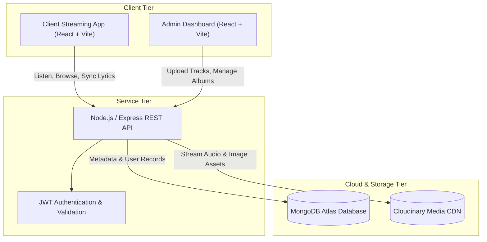

# TuneStream - Full-Stack Audio Streaming Platform

An end-to-end full-stack web platform for streaming audio, managing digital music catalogs, and handling media assets. Built with modern web technologies and designed with scalable cloud and quality assurance principles.

---

## Architecture Overview

TuneStream is structured as a decoupled multi-tier web application:



---

## Modules

| Component | Directory | Description |
| :--- | :--- | :--- |
| **Client Web App** | `Tunestream-home/` | Modern audio player with synchronized lyric scrolling, playlist view, responsive player bar, and user account management. |
| **Admin Portal** | `Tunestream-admin/` | Management console for catalog maintainers to upload media files, create albums, and manage existing listings. |
| **API Backend** | `Tunestream-backend/` | RESTful API built on Express.js providing authentication, catalog querying, multipart uploads, and error handling. |

---

## Tech Stack

- **Frontend**: React 18, Vite, Tailwind CSS, Lucide Icons, Framer Motion
- **Backend**: Node.js, Express.js, Multer (multipart handling)
- **Database & Storage**: MongoDB Atlas, Mongoose ODM, Cloudinary CDN
- **Security & Validation**: JSON Web Tokens (JWT), Bcrypt password hashing, Joi validation schemas
- **Testing & Quality Assurance**: Postman API collections, ESLint code standards, CI/CD pipeline automation

---

## Getting Started

### Prerequisites
- Node.js (v18 or higher)
- npm or pnpm
- MongoDB Atlas connection string
- Cloudinary credentials (Cloud Name, API Key, API Secret)

---

### 1. Backend Service Setup

```bash
cd Tunestream-backend
npm install
```

Configure your environment file:
```bash
cp .env.example .env
```
Fill in the credentials in `.env`:
```env
PORT=4000
MONGODB_URI=your_mongodb_connection_string
CLOUDINARY_NAME=your_cloudinary_name
CLOUDINARY_API_KEY=your_cloudinary_key
CLOUDINARY_SECRET_KEY=your_cloudinary_secret
JWT_SECRET=your_jwt_secret
```

Start the API server:
```bash
npm run server
```

---

### 2. Admin Portal Setup

```bash
cd ../Tunestream-admin
npm install
npm run dev
```
The Admin Portal will run at `http://localhost:5173` (or the configured Vite port).

---

### 3. Client Streaming App Setup

```bash
cd ../Tunestream-home
npm install
npm run dev
```
The Client App will run at `http://localhost:5174` (or next available port).

---

## API Reference

### Songs
| Method | Endpoint | Description | Auth Required |
| :--- | :--- | :--- | :--- |
| `GET` | `/api/song/list` | Retrieve all available songs | No |
| `POST` | `/api/song/add` | Upload a new audio track and artwork | Admin |
| `POST` | `/api/song/remove` | Delete a track by ID | Admin |

### Albums
| Method | Endpoint | Description | Auth Required |
| :--- | :--- | :--- | :--- |
| `GET` | `/api/album/list` | Retrieve all albums | No |
| `POST` | `/api/album/add` | Create an album with cover art | Admin |
| `POST` | `/api/album/remove` | Delete an album by ID | Admin |

### Authentication
| Method | Endpoint | Description | Auth Required |
| :--- | :--- | :--- | :--- |
| `POST` | `/api/auth/register` | Create a new user account | No |
| `POST` | `/api/auth/login` | Authenticate user and receive JWT | No |

### Lyrics
| Method | Endpoint | Description | Auth Required |
| :--- | :--- | :--- | :--- |
| `GET` | `/api/lyrics` | Fetch synchronized LRC format lyrics | No |

---

## Quality Assurance & Testing

TuneStream incorporates cloud and API QA practices:
1. **API Regression Testing**: Validating status codes, schema contracts, and latency across all endpoints using automated test collections.
2. **Media Upload Resilience**: Testing edge cases in multipart audio/image uploads (large files, invalid mimetypes, network timeouts).
3. **Continuous Integration**: Automated linting and build validation on every pull request via GitHub Actions.

---

## License

This project is licensed under the MIT License - see the [LICENSE](LICENSE) file for details.
